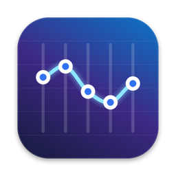
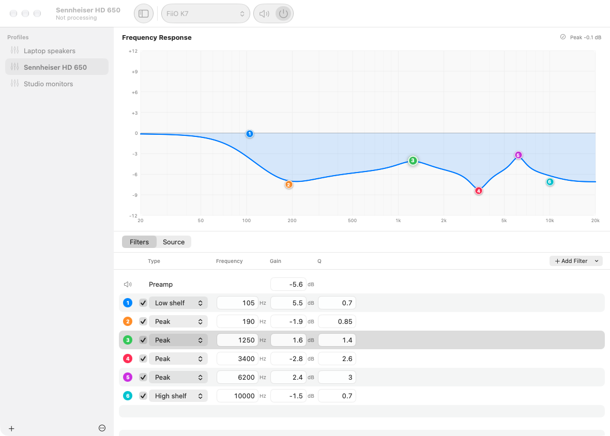

<p align="center">
  
</p>

<h1 align="center">APOMac</h1>

<p align="center">
  A system-wide parametric equalizer for macOS that reads <a href="https://sourceforge.net/projects/equalizerapo/">Equalizer APO</a> configuration files.<br>
  No virtual audio driver, no kernel extension, nothing to select in Sound settings.
</p>

<p align="center">
  <a href="https://github.com/mkroplewski/APOMac/releases/latest"><b>Download the latest release</b></a>
</p>



## Features

- **Equalizes every app.** APOMac processes everything playing through your current Mac output: speakers, headphones, USB DACs, AirPods.
- **Uses Equalizer APO profiles.** Import an Equalizer APO profile folder or a single file such as an [AutoEQ](https://autoeq.app) `ParametricEQ.txt`. Your existing Windows configurations work as they are.
- **Changes apply instantly.** Drag a band on the graph, type a value, or edit the source: you hear the change within milliseconds, with a click-free crossfade.
- **Visual and source editing.** Simple profiles are edited visually. Advanced ones (`Include`, `If`, `Channel`, `GraphicEQ`, `Convolution`, …) are edited as text, with syntax highlighting, error checking and a live response graph.
- **Stays out of the way.** It lives in the menu bar when its window is closed, can open at login, and uses a few percent of one CPU core even with long convolution filters.

## Requirements

macOS 15 Sequoia or later, on Apple silicon or Intel.

## Install

1. Download **APOMac-x.y.z.dmg** from the [latest release](https://github.com/mkroplewski/APOMac/releases/latest).
2. Open the DMG and drag **APOMac** onto **Applications**.
3. Open APOMac from Applications. If macOS says it can't verify the developer, see [First launch](#first-launch-gatekeeper) below.
4. Click **Allow** when APOMac asks to record system audio. That is how it receives the sound it equalizes. The audio never leaves your Mac, and APOMac makes no network connections.
5. Optional: turn on **Open at login** in Settings (the gear button in the toolbar, **Settings…** in the menu bar icon, or ⌘,).

### First launch (Gatekeeper)

Release builds are signed and notarized when the project has an Apple Developer ID. Until then, macOS blocks the first launch:

- Open **System Settings → Privacy & Security**, scroll down, and click **Open Anyway** next to the APOMac message; or
- run `xattr -dr com.apple.quarantine /Applications/APOMac.app` in Terminal.

### Uninstall

Quit APOMac from its menu bar icon and move it to the Trash; its login item goes with it. Your profiles stay in the `APOMac` folder in your home folder; settings are in `~/Library/Preferences/com.apomac.app.plist`. Delete them too if you don't need them. No drivers or system files are installed.

## Using APOMac

**Profiles.** Each profile is a plain Equalizer APO config folder in `~/APOMac` (the `APOMac` folder in your home folder), for example `~/APOMac/Sennheiser HD 650/config.txt`. **Show Profiles Folder** in the sidebar's **+** menu opens it. The selected profile is the one you hear.

- Create profiles with **+** in the sidebar, or import them with **File → Import…** (⌘O) or by dropping folders or `.txt` files onto the window.
- You can also manage the folder directly: copy an Equalizer APO config folder in, rename or delete folders in Finder, or edit `config.txt` and included files in any text editor. APOMac picks up the changes immediately.
- For headphones, search your model on [autoeq.app](https://autoeq.app), choose *Equalizer APO ParametricEQ*, and import the downloaded file.

**Editing.**
- Drag the numbered handles on the graph to change frequency and gain.
- Double-click the graph to add a peak filter.
- In the filter list, use ↑/↓ to nudge a value (⇧ for bigger steps).
- The **Source** tab shows the profile as Equalizer APO text; click a diagnostic to jump to its line.
- Changes are saved automatically. If the source has an error, the last working version keeps playing.

**Output device.** APOMac always processes the macOS sound output, because that's where apps send their audio. The output picker in the toolbar and the menu bar switches the macOS output, and changing it elsewhere (Control Center, plugging in headphones) is followed automatically.

**Comparing.** **Bypass** (⌘B) crossfades to the unprocessed sound so you can compare. **Processing** (⇧⌘E) turns APOMac off completely.

**Clipping.** If the response rises above 0 dB, APOMac warns that the output may clip. **Add Preamp** lowers the preamp by the right amount.

## Equalizer APO compatibility

APOMac implements the post-mix part of the [configuration reference](https://sourceforge.net/p/equalizerapo/wiki/Configuration%20reference/):

| Supported | Notes |
| --- | --- |
| `Preamp`, `Delay`, `Copy` | |
| `Filter` | `PK`/`PEQ`/`Modal`, `LP`/`LPQ`, `HP`/`HPQ`, `BP`, `NO`, `AP`, `LS`/`LSC`/`HS`/`HSC` (with Q, BW or slope), `IIR` |
| `GraphicEQ` | Minimum-phase FIR, like Equalizer APO |
| `Convolution` | WAV/AIFF/CAF impulse responses, resampled to the device rate when needed |
| `Include`, `Channel`, `Device`, `Stage` | Windows paths (`C:\…\config\file.txt`, backslashes) are mapped into the profile folder |
| `If`/`ElseIf`/`Else`/`EndIf`, `Eval`, `` `inline expressions` `` | Including `sampleRate`, `deviceName`, `outputChannelCount`, … |

Not supported, and kept in the file with a warning: `VSTPlugin`, `LoudnessCorrection`, the Windows registry functions, and the `pre-mix`/`capture` stages (macOS only exposes the final mix).

## Troubleshooting

- **No effect, or "APOMac needs permission".** Allow APOMac in **System Settings → Privacy & Security → Screen & System Audio Recording** (the *System Audio Recording Only* list), then click **Try Again**.
- **Permission is requested again after updating.** Builds without a Developer ID get a new signature with every release, so macOS treats each update as a new app.
- **One app isn't equalized.** That app is probably set to output to a specific device (common in DAWs and some music players), or uses a device exclusively. Point it at the system output instead.
- **Something sounds wrong.** Quit APOMac and audio immediately returns to normal; nothing stays rerouted.

## How it works

APOMac creates a private Core Audio *process tap* on the output device. The tap receives what other apps play to that device and mutes the original. The tap and the device are combined into a private aggregate device with drift compensation, so a single real-time callback reads the tapped audio, runs the compiled filter graph and writes the result back to the same hardware, on one clock and at the device's sample rate.

Profiles are compiled off the audio thread into a graph of vDSP biquads, IIR filters and a zero-latency partitioned FFT convolver (for GraphicEQ and Convolution). Graphs are handed to the render thread lock-free and crossfaded, and are never allocated or freed on that thread.

```
Sources/
  APOEngine/         Equalizer APO parser, expression evaluator, compiler and DSP graph
  APOAudioRuntime/   Core Audio tap, aggregate device and real-time graph switching
  APOMacApp/         SwiftUI app
Tests/               Engine and app tests (swift test)
packaging/           Info.plist and app icon
scripts/             App bundle / DMG packaging and icon generation
```

## Building from source

Requires Xcode 26 or later.

```sh
swift build
swift test
swift run APOMacApp          # runs without an app bundle; "Open at Login" needs the bundle
```

To build the app bundle and a DMG:

```sh
./scripts/package-app.sh                          # .build/app-bundle/APOMac.app
UNIVERSAL=1 MAKE_DMG=1 ./scripts/package-app.sh   # Apple silicon + Intel, plus APOMac-<version>.dmg
```

`CODESIGN_IDENTITY` (a *Developer ID Application* identity) and `NOTARY_PROFILE` (a `notarytool` keychain profile) produce a signed, notarized DMG. See the script header for all options.

### Releasing

Push a version tag, for example `git tag v0.2.0 && git push origin v0.2.0`. The [release workflow](.github/workflows/release.yml) runs the tests, builds a universal DMG and publishes it with a SHA-256 checksum as a GitHub release. To sign and notarize releases, add the Developer ID secrets listed at the top of that workflow.

## Contributing

Bug reports, Equalizer APO configurations that don't behave as on Windows, and pull requests are welcome. Please run `swift test` before opening a pull request, and add a test for engine changes.

## License

APOMac is free software under the [GNU General Public License v2](LICENSE) (GPL-2.0-only). Its processing engine is a Swift port of the behaviour of [Equalizer APO](https://sourceforge.net/projects/equalizerapo/) by Jonas Thedering and contributors, which is also GPL-licensed. See [NOTICE.md](NOTICE.md) for attribution.
